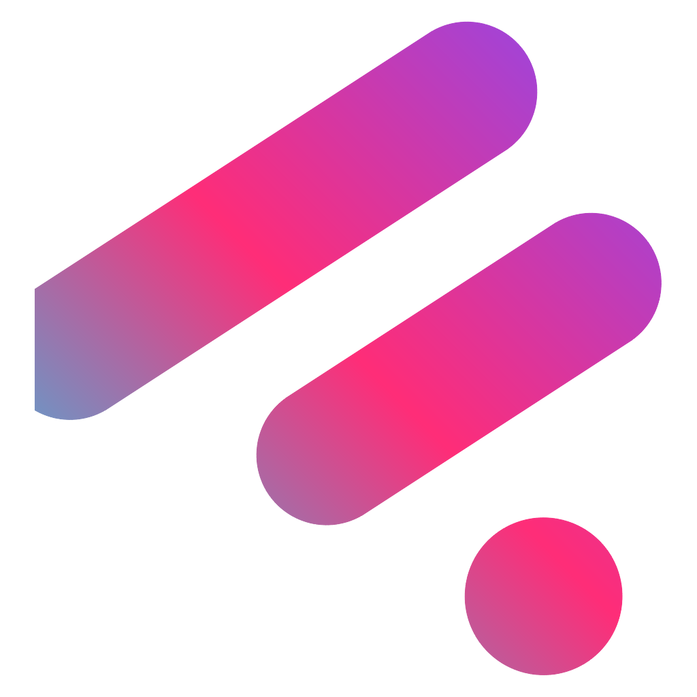
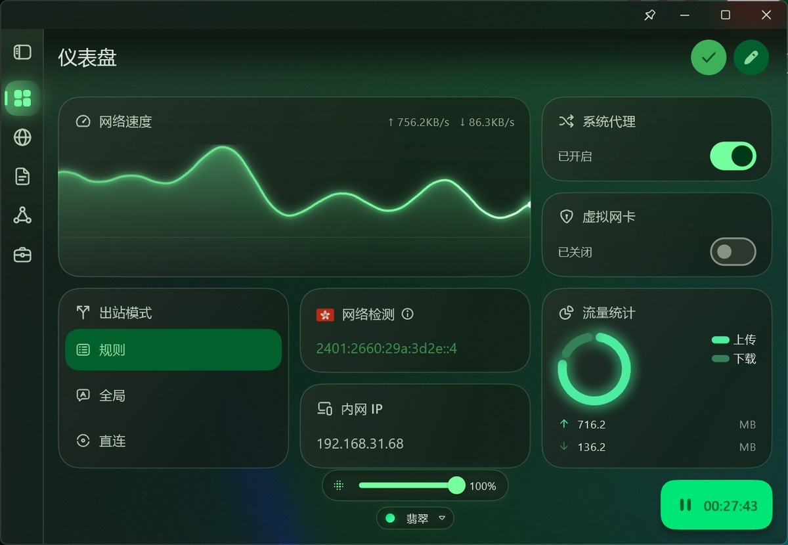
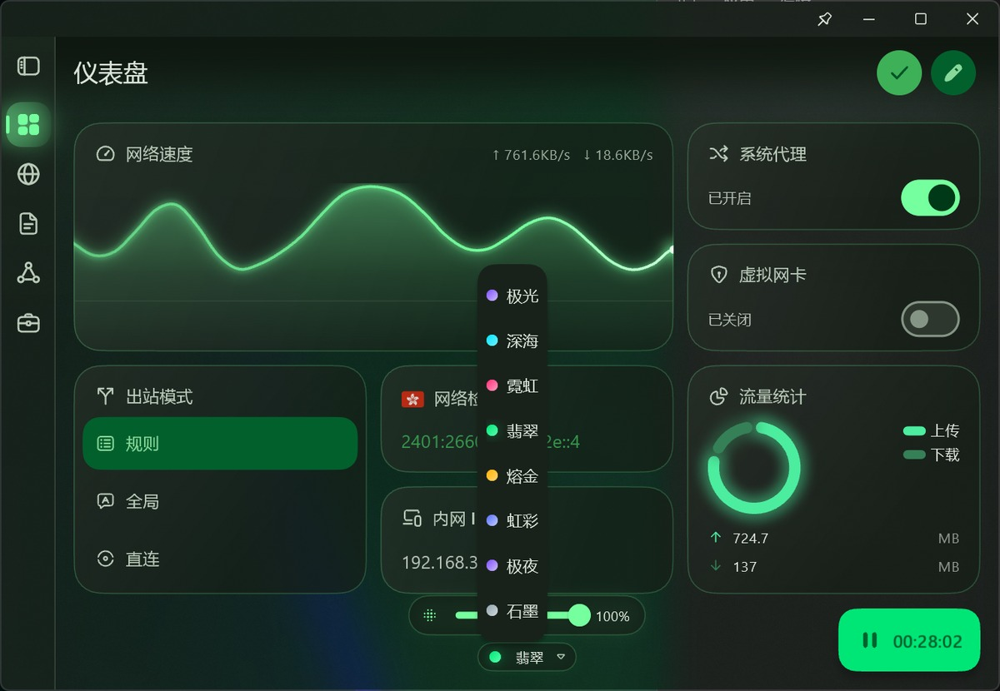

<div align="center">



# FlClash Aurora

基于 ClashMeta 的多平台代理客户端。**本仓库是个人定制构建**，在上游基础上做了界面美化。

**简体中文** · [English](README_EN.md)

[](https://github.com/HNAYZDF/FlClash-Aurora/releases/latest)
[](https://github.com/HNAYZDF/FlClash-Aurora/releases)
[](LICENSE)

[下载](#下载) · [改动清单](CUSTOMIZATIONS.md) · [从源码构建](#从源码构建) · [上游说明](README_zh_CN.md)

</div>

> [!IMPORTANT]
> **这是个人定制构建，不是官方版本。**
> 上游自动更新已关闭 —— 本构建报告的是上游版本号，更新器会提示安装官方版，
> 而安装官方版会覆盖下面全部定制。需要更新请从本仓库重新构建。

## 界面预览

<p align="center">
  
</p>

<p align="center">
  
</p>

## 这个版本有什么不同

### 磨砂玻璃窗口

使用 Windows 原生 acrylic 特效，窗口半透明并**模糊后方桌面**。
特效未生效时自动退回不透明，不会露出裸窗口底色。

### 透明度 1–100% 可调

仪表盘底部与设置页各有一个滑块。拉到 **100% 时底色、面纱和极光光晕全部归零**，
只剩控件画在磨砂桌面上。

光晕完全淡出后会自动停掉重绘定时器 —— 否则就是在每帧重绘一张看不见的全屏模糊。
把透明度拉回一点，动画自动恢复。

### 八套中文皮肤

| 皮肤 | 强调色 | 配色变体 |
| --- | --- | --- |
| 极光 | 紫罗兰 | 内容主题 |
| 深海 | 青色 | 活力 |
| 霓虹 | 品红 | 高保真 |
| 翡翠 | 翠绿 | 高保真 |
| 熔金 | 琥珀 | 活力 |
| 虹彩 | 靛蓝 | 彩虹 |
| 极夜 | 紫罗兰 | 内容主题（纯黑） |
| 石墨 | 蓝灰 | 中性 |

皮肤只记录「强调色 + 配色变体 + 纯黑」三项 —— 不新增持久化字段，
因此**能随配置一起备份恢复**，也不会因为降级回官方版而丢失。

> 每个皮肤的配色变体都刻意避开了 `expressive` 与 `fruitSalad`：
> 这两个变体会把主色相旋转 +240° 和 −50°，会让叫「霓虹」的皮肤渲染成别的颜色。
> 仓库里有一条测试锁住这个约束。

### 其余界面改动

- **极光背景** —— 整窗铺一层缓慢漂移的渐变光晕，颜色由当前皮肤推导，强度随配色鲜艳度自动调节
- **玻璃卡片** —— 半透明填充 + 斜切高光，悬停时轻微上浮
- **霓虹图表** —— 折线图与环形图带发光描边、三段渐变填充与端点光点
- **侧边栏** —— 选中项改为渐变胶囊 + 光晕 + 强调色图标
- **开始按钮** —— 呼吸填充 + 向外扩散的雷达波纹
- **应用图标** —— 重绘的方圆形图标与四种状态托盘图标

## 下载

到 [Releases](https://github.com/HNAYZDF/FlClash-Aurora/releases/latest) 下载：

| 文件 | 说明 |
| --- | --- |
| `FlClash-*-setup.exe` | 安装包，含开始菜单与卸载程序 |
| `FlClash-*-windows-amd64.zip` | 便携压缩包，解压即用 |

> 安装包会先结束正在运行的 FlClash。若系统代理开着，安装期间会有短暂断网，装完启动即恢复。

## 从源码构建

```bash
git clone --recursive https://github.com/HNAYZDF/FlClash-Aurora.git
cd FlClash-Aurora
flutter pub get
flutter build windows --release --dart-define-from-file=env.json
```

`env.json` 由 `setup.dart` 生成。**其中 `FEATURE_SIDEBAR_BLUR` 必须为 `true`**，
否则窗口不会应用磨砂特效，透明度滑块会失效并被禁用：

```json
{ "APP_ENV": "stable", "FEATURE_SIDEBAR_BLUR": "true" }
```

用 `dart setup.dart windows --env stable` 打包时会自动带上这个开关。

## 体积与性能

| 项目 | 上游原样 | 本版本 |
| --- | --- | --- |
| 安装后占用 | 157.2 MB | **137.6 MB** |
| 安装包 | 42.69 MB | **40.43 MB** |
| 便携 zip | 67.80 MB | **62.59 MB** |
| 空闲 CPU | — | 单核 **1.4%** |

不再打包只在 `geodata-mode: true` 时才会读取的旧版 `GEOIP.dat`（19.6 MB），
安装包压缩升到 Inno Setup 的最强档 `lzma2/ultra64`。
细节与取舍见 [CUSTOMIZATIONS.md](CUSTOMIZATIONS.md)。

## 已知限制

- Win11 上 acrylic 在拖动或缩放窗口时可能有轻微延迟 —— 这是 DWM 对旧版
  `SetWindowCompositionAttribute` 的固有行为。
- 设置里的「侧边栏背景模糊」实际控制整个窗口的磨砂开关；关掉它窗口变回不透明，
  透明度滑块随之禁用。
- 本版本**不含 `GEOIP.dat`**。若把 `geodata-mode` 改成 `true`，`GEOIP` 规则会失效，
  需先在应用内「工具 → Geo 资源」更新一次。
- 上游测试中有 6 项在改动前就失败（集中在 `core/event.dart`、`l10n_labels.dart`
  等本仓库未修改的文件），与本定制无关。

---

## 鸣谢

界面美化：哔哩哔哩 **[hnayzdf](https://space.bilibili.com/431149392)**

本项目基于 [chen08209/FlClash](https://github.com/chen08209/FlClash) 修改，
遵循 **GPL-3.0** 协议，著作权归 FlClash 全体贡献者所有。完整改动见 [CUSTOMIZATIONS.md](CUSTOMIZATIONS.md)。
